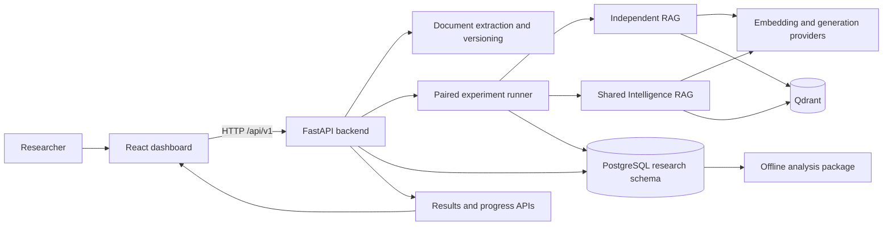

# Smart Cloud

Smart Cloud is a research prototype for evaluating **organization-aware,
demand-driven shared AI document intelligence**. It investigates whether
multiple consumers can share prepared document knowledge to reduce repeated
AI processing—while preserving useful retrieval and answers, acceptable
latency, document freshness, and access boundaries.

The project is an experimental instrument, not a claim that sharing is always
cheaper or better. The central hypothesis is deliberately testable: depending
on reuse, provider prices, and coordination overhead, the shared approach may
or may not outperform independent processing. Research plans, assumptions,
metrics, and open questions are documented under [`docs/`](./docs/).

## At a glance

- **Purpose:** Compare document-preparation reuse strategies under controlled,
  repeatable workloads.
- **Control:** Independent RAG; every simulated consumer prepares its own
  document chunks and vectors.
- **Treatment:** Shared RAG; the first consumer prepares the document on demand
  and later consumers may reuse its prepared chunks and vectors.
- **Important boundary:** Only document-preparation artifacts are shared.
  Every request still performs a fresh query embedding, retrieval, and answer
  generation. Generated answers and provider-side prompt/context caches are
  not the object of this comparison.
- **User interface:** A web dashboard to upload/select documents, configure
  experiments, follow runs, and inspect results.

## How the system works



### Typical researcher workflow

1. **Prepare the services.** Start PostgreSQL and Qdrant, then configure the
   backend connection settings.
2. **Register a document.** Upload a PDF, `.txt`, or Markdown file. The API
   extracts searchable text, hashes the original file, and stores a version
   for experiments. Text-searchable PDFs are supported; scanned PDFs requiring
   OCR are not.
3. **Configure an experiment.** Choose the document version, workload,
   consumer count, random seed, repetition count, chunking and retrieval
   settings, and mock or Gemini providers.
4. **Execute the comparison.** The runner uses a generated consumer workload
   to run both strategies. The independent strategy indexes per consumer; the
   shared strategy prepares on first demand and reuses eligible artifacts.
5. **Inspect the evidence.** Preparation events and per-request measurements
   are persisted. The dashboard displays run progress and summaries for
   estimated cost, latency, reuse, retrieval quality, answer correctness, and
   security checks. The analysis package can also evaluate stored run data
   outside the web application.

## Experimental design

The project is built around a **paired control-versus-treatment comparison**.
Strategies are evaluated against the same selected document and benchmark
questions, with the experiment configuration recording workload, chunking,
retrieval, provider, seed, and repetition settings. This is intended to make
the effect of preparation reuse easier to isolate from changes in the task.

| Dimension | Independent RAG (control) | Shared Intelligence RAG (treatment) |
| --- | --- | --- |
| Document preparation | Each consumer chunks, embeds, and indexes the document independently. | The first eligible consumer prepares the document; subsequent consumers can reuse the prepared chunks and vectors. |
| Vector index scope | Scoped to the run, repetition, and consumer. | Shared across consumers within the run and repetition. |
| Query processing | Fresh query embedding, retrieval, and answer generation for every question. | The same fresh per-question processing; the experiment does not memoize answers. |
| Main effect measured | Baseline cost and latency of independent preparation. | Preparation avoided, reuse achieved, and overhead introduced by sharing. |

The research evaluates economic outcomes alongside operational constraints.
These include preparation and query costs, reuse rate, first-use and warm-use
latency, retrieval recall, answer correctness, document-version freshness,
and unauthorized-retrieval checks. Whether the shared approach achieves useful
savings is an empirical result, not an assumption built into the README.

For precise protocol details, see the [experimental design](./docs/research/experimental-design.md),
[metric definitions](./docs/research/metrics.md), and
[research hypothesis](./docs/research/hypothesis.md).

## Technology stack

Technology versions below reflect the project manifests; dependency ranges
may resolve to newer compatible patch or minor versions.

### Frontend

- **React 19** and **TypeScript 6** for the typed, component-based dashboard.
- **Vite 8** for local development, hot-module replacement, and production
  builds; `/api` requests are proxied to the local backend.
- **Tailwind CSS 4** for styling.
- **React Router 7** for page navigation.
- **TanStack Query 5** for fetching and caching API state.
- **React Hook Form** and **Zod** for form handling and validation.
- **Recharts** for research visualizations and **Lucide React** for icons.
- **Oxlint** for frontend linting.

### Backend

- **Python 3.12+**, **FastAPI**, and **Uvicorn** for the asynchronous HTTP API.
- **Pydantic 2** and **pydantic-settings** for request schemas and
  environment-based configuration.
- **SQLAlchemy 2** for PostgreSQL access, with **asyncpg** for application
  connections and **Alembic** migrations. The migration environment uses
  **psycopg2**.
- **Qdrant** and `qdrant-client` for vector collections and similarity
  retrieval.
- Provider interfaces separate embedding and answer generation from the
  experiment engine. Implementations include deterministic local mock
  providers and Google Gemini integrations.
- **pypdf** extracts text from supported PDFs; text and Markdown uploads are
  also supported.
- **Pandas, NumPy, SciPy, and Matplotlib** support result loading, analysis,
  and statistical or plotting workflows.
- **structlog** provides structured application logging.

### Data and quality tooling

- **PostgreSQL** stores document-version metadata, experiment configurations,
  runs, preparation events, request measurements, and related research data.
  These tables and Alembic's version table are isolated in the `research`
  schema.
- **Qdrant** stores per-run vector collections for the independent and shared
  strategies. It is a separate service from PostgreSQL.
- **pytest** and **pytest-asyncio** run backend tests; **Ruff** and **mypy**
  support linting, formatting, and type checking.
- **npm** manages the frontend dependencies; the committed lockfile records
  the frontend dependency resolution.

## Architecture and code map

```text
.
├── README.md
├── docs/                  Research proposal, protocol, metrics, and setup notes
├── front/                 React dashboard and Vite configuration
│   └── src/
│       ├── api/            Typed API client
│       ├── components/     Shared page layout and UI components
│       └── pages/          Overview, experiments, run details, analysis, diagnostics
└── server/
    ├── app/
    │   ├── api/v1/         Documents, experiments, results, and health endpoints
    │   ├── documents/      Extraction, chunking, versioning, and persistence
    │   ├── experiments/    Workload generation and paired experiment runner
    │   ├── rag/            Independent and shared retrieval strategies
    │   ├── embeddings/     Mock and Gemini embedding providers
    │   ├── generation/     Mock and Gemini answer-generation providers
    │   └── db/             PostgreSQL models/sessions and Qdrant lifecycle
    ├── analysis/           Run loading and cost, latency, reuse, and comparison summaries
    ├── migrations/         Alembic revisions for the research schema
    └── tests/              Backend unit and integration tests
```

The API is versioned under `/api/v1`. The frontend uses the same-origin `/api`
path during Vite development, which is proxied to `http://localhost:8000`.
PostgreSQL and Qdrant are independent backing services; starting the web
application alone does not start either dependency.

## Requirements

- Python **3.12 or newer**
- Node.js and npm
- PostgreSQL, with a database and user created for this project
- Qdrant, reachable at `localhost:6333` (REST) and `localhost:6334` (gRPC)
- Docker, if you want to run Qdrant with the example below

Start Qdrant locally:

```bash
docker run --detach --name smart-cloud-qdrant \
  -p 6333:6333 -p 6334:6334 \
  qdrant/qdrant
```

The command creates a named container. If that container already exists,
start it with `docker start smart-cloud-qdrant` instead of creating it again.

## Local development setup

### 1. Configure PostgreSQL

Create the PostgreSQL database and a user with permission to create and modify
objects in it. The default example configuration uses `smart-cloud` as the
database name and `localhost:5432`; update the credentials and connection
settings for your environment.

### 2. Configure and prepare the backend

From the repository root:

```bash
cp server/.env.example server/.env
```

Edit `server/.env` and set `DB_NAME`, `DB_USER`, and `DB_PASSWORD`. Set
`DB_HOST` and `DB_PORT` if PostgreSQL is not at the defaults. Qdrant defaults
to `localhost:6333` and `localhost:6334`; change `QDRANT_HOST`, `QDRANT_PORT`,
and `QDRANT_GRPC_PORT` if needed. `GEMINI_API_KEY` is only needed for
Gemini-backed experiments; the mock providers do not require an API key.

Create a Python environment, install the backend, and apply the database
migrations. Alembic reads connection details from the process environment, so
export the values from `.env` before invoking it:

```bash
cd server
python3 -m venv .venv
source .venv/bin/activate
pip install -e .
set -a
source .env
set +a
PYTHONPATH=. .venv/bin/alembic upgrade head
```

### 3. Start the backend API

Keep the terminal in `server/` and the virtual environment activated:

```bash
PYTHONPATH=. .venv/bin/uvicorn app:app --reload --host 0.0.0.0 --port 8000
```

- Interactive API documentation: <http://localhost:8000/api/docs>
- ReDoc: <http://localhost:8000/api/redoc>
- Dependency health: <http://localhost:8000/api/v1/health>
- Liveness probe: <http://localhost:8000/api/v1/health/live>

The backend lifespan initializes the PostgreSQL connection pool and Qdrant
client. The health endpoint reports the state of these backing services.

### 4. Start the dashboard

In a second terminal, from the repository root:

```bash
cd front
npm install
npm run dev
```

Open <http://localhost:5173>. The Vite server forwards requests under `/api`
to the backend at `http://localhost:8000`.

## Configuration and provider choices

Backend configuration is loaded from `server/.env`. The provided
[`server/.env.example`](./server/.env.example) lists the supported database,
Qdrant, Gemini, and application settings. Do not commit secrets from a local
`.env` file.

The experiment configuration selects the workload and provider behavior. A
mock provider is useful for checking local flows and repeatability without
external AI credentials or provider charges. Mock embeddings are
deterministic synthetic vectors, however; they do **not** model the semantic
quality of a real embedding model and should not be treated as meaningful
retrieval-quality evidence. Use a configured real provider for experiments
that need to evaluate semantic retrieval or provider costs.

Gemini-backed processing requires a valid key and may incur provider charges.
Review provider settings and experiment configuration before launching paid
workloads. Estimates shown by the analysis are not necessarily provider
invoices; consult the metrics documentation for accounting boundaries.

## Tests and development commands

### Backend

Install the optional development dependencies from `server/`:

```bash
pip install -e ".[dev]"
```

Run unit tests:

```bash
PYTHONPATH=. .venv/bin/pytest tests/unit/ -v
```

Integration tests may require running PostgreSQL and Qdrant:

```bash
PYTHONPATH=. .venv/bin/pytest -v
```

Other configured backend checks:

```bash
.venv/bin/ruff check .
.venv/bin/ruff format --check .
.venv/bin/mypy app analysis tests
```

### Frontend

Run the production TypeScript and Vite build, or run the configured linter:

```bash
npm run build
npm run lint
```

For the full local development guide and independent analysis examples, see
[`docs/development-setup.md`](./docs/development-setup.md).

## Research and measurement documentation

- [Research proposal](./docs/shared_ai_cloud.md) — motivation and research
  contribution.
- [Research hypothesis](./docs/research/hypothesis.md) — falsifiable scope,
  research questions, and boundaries.
- [Experimental design](./docs/research/experimental-design.md) — control and
  treatment strategies, controlled variables, and workload protocol.
- [Metrics](./docs/research/metrics.md) — cost models and operational metric
  definitions.
- [Research decisions](./docs/research/decisions.md) — design rationale,
  assumptions, and deferred work.
- [Development setup](./docs/development-setup.md) — additional local
  workflow, testing, linting, and analysis commands.

## Scope and limitations

This repository implements an experimental comparison, not a complete
production multi-tenant AI platform. In particular:

- Benchmark consumers and workload schedules are experiment inputs; do not
  assume the dashboard implements end-user identity management or production
  organizational authentication.
- Shared-vector authorization behavior is part of the experiment design and
  retrieval path. It should not be interpreted as a substitute for a
  production security review, identity integration, or deployment-specific
  access-control testing.
- Current document extraction supports text-searchable PDF, `.txt`, and
  Markdown files; image-only scanned PDFs and OCR are not supported.
- The research focuses on reusing chunks and document embeddings. It excludes
  final-answer caching, semantic query caching, and provider-side prompt
  caching from the primary comparison.
- Cost, quality, and latency results depend on the selected corpus, workload,
  provider, pricing assumptions, and infrastructure. Results should be
  interpreted with those settings and the documented methodology.
